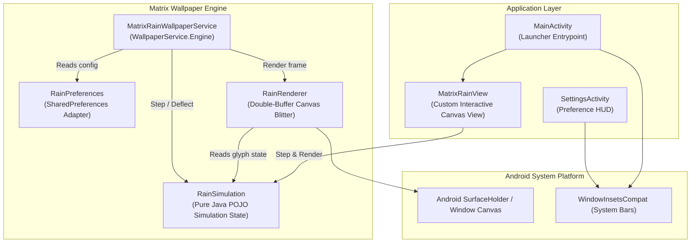

# Architecture & System Design: Matrix Rain

* **Domain:** Android System Wallpaper & Graphic Simulation
* **Status:** Implemented & Verified
* **Platform Invariant:** Android 7.0+ (API 24 to 35+), 100% Free & Open Source (F-Droid)
* **License:** MIT

---

## 1. Domain Modeling & Architectural Intent

Matrix Rain is an ultra-low-overhead digital rain simulation engineered for AMOLED and high-refresh Android displays. The system is designed to provide cinema-authentic visual fidelity while enforcing three invariant engineering bounds:

1. **Energy Conservation Invariant (0% Standby CPU Drain)**:
   - Rendering operates strictly on event-driven looper pacing.
   - When the wallpaper surface is obscured by a foreground application or the screen is powered down, all runner callbacks are immediately deregistered from the Android Main Looper (`handler.removeCallbacks(drawRunner)`). Zero CPU wakeups or thread loops execute during standby.
2. **Display Power Invariant (True OLED `#000000` Black)**:
   - The canvas background strictly clears to `#000000`. On AMOLED/OLED displays, pixels with hex value `#000000` draw zero current, yielding maximum battery efficiency and infinite contrast.
   - Phosphorescent glyph decay is achieved via double-buffered alpha blitting: drawing a semi-transparent black rectangle (`Color.BLACK`, $\alpha = 10$) across an offscreen bitmap each frame, allowing trailing characters to naturally fade to pure `#000000`.
3. **Memory Ceiling & Allocation Bounds**:
   - Zero per-frame object allocations in the draw loop.
   - Canvas `Paint` objects, character arrays, and primitive column vectors are pre-allocated during surface configuration (`onSurfaceChanged`).
   - The offscreen double-buffer bitmap is bounded strictly by screen dimensions (e.g., $1080 \times 2400 \times 4\text{ bytes} \approx 10.3\text{ MB}$ in `Bitmap.Config.ARGB_8888`), and protected by thread-safe synchronization locks against asynchronous surface teardowns.

---

## 2. Component Architecture

The Android application architecture is structured into decoupled, single-responsibility units:

### Component Boundaries

#### `RainSimulation` (Pure Java Domain Model)
* **Constraints**: Zero Android framework dependencies (`java.util.Random` only). Runs deterministically on standard JVM runtimes without emulators.
* **State Vectors**:
  - `dropY`: Vertical row head positions for each active column.
  - `speeds`: Frame delay divisor per column ($1 \le s \le 3$).
  - `frameCounts`: Countdown timer before advancing a drop to the next row.
  - `previousChars`: Trailing glyph character cache.
  - `columnType`: Stream taxonomy (`0 = Standard`, `1 = Background Depth`, `2 = Crimson Virus`, `3 = Gold Neo`).
  - `wordActiveIndex`: Position index within active easter-egg messages (`"MATRIX"`, `"SYSTEM"`, `"HACK"`, `"WAKE UP"`, `"NEO"`).
* **Glyph Distribution**:
  - 60% Japanese Half-width Katakana (`0xFF66` to `0xFF9D`).
  - 25% Decimal Digits (`0`–`9`).
  - 15% ASCII Operator and Punctuation symbols (`0x21` to `0x7A`).

#### `RainRenderer` (Double-Buffered Canvas Blitter)
* **Constraints**: Pre-allocates all `Paint` instances and offscreen buffers.
* **Double Buffering & Thread Safety**:
  - Owns `Bitmap bufferBitmap` and `Canvas bufferCanvas`.
  - Employs an internal `renderLock` object to prevent `bufferBitmap.recycle()` from racing with active frame blits during screen rotation or surface teardown.
* **Paint Cache**:
  - `textPaint`: Base stream green (`#00FF00`).
  - `backgroundPaint`: Dimmed depth layer green (`#004400`).
  - `headPaint`: Glowing white-green head glyph (`#EEFFEE` with 8px blur shadow).
  - `virusPaint`: Crimson stream (`#FFFF0000` with 5px blur shadow).
  - `goldPaint`: Amber Neo stream (`#FFFFD700` with 5px blur shadow).
  - `fadePaint`: OLED decay mask (`#000000`, $\alpha = 10$).

#### `RainPreferences` (Configuration Adapter)
* **Constraints**: Centralized contract between `SharedPreferences` and execution components.
* **Metric Conversions**:
  - Frame delay: $\tau = 36 - \lfloor (\text{speedProgress} \times 20) / 100 \rfloor$ (36ms to 16ms range, ~28fps to 60fps).
  - Font size (Glyph Size): $\phi = 28 + \lfloor (\text{glyphSizeProgress} \times 28) / 100 \rfloor$ (28px to 56px unscaled base range, scaled by display density multiplier).
  - Feature toggles: Red Virus drops, Gold Neo drops, Hidden Messages, Background Depth, Glitch Effects, Touch Interaction.

#### `MatrixRainView` (Interactive View Component)
* Extends `android.view.View` to provide real-time interactive Matrix rain inside standard activities (`MainActivity`).
* Integrates touch listeners to calculate screen column coordinate ($x / \phi$) and invoke `simulation.deflect(col)`.
* Adheres to lifecycle visibility checks (`onWindowVisibilityChanged`) to guarantee 0% idle battery consumption when the parent activity is not active.

---

## 3. System Inset & Theming Specification

To ensure compatibility with modern Android edge-to-edge system standards (Android 14, 15+ / `targetSdk 35`):

1. **Theme Root**:
   - The application window theme is anchored to `Theme.MaterialComponents.NoActionBar`.
   - `android:windowBackground`, `android:statusBarColor`, and `android:navigationBarColor` are set to `#000000`.
   - System bar icons are styled light (`android:windowLightStatusBar = false`, `android:windowLightNavigationBar = false`) to guarantee high contrast over the pitch-black header and footer.
   - System contrast enforcement is disabled (`enforceStatusBarContrast = false`, `enforceNavigationBarContrast = false`) to eliminate OS-injected translucent gray or white scrims.
2. **Safe-Area Insets**:
   - Activity layouts pad content dynamically via `ViewCompat.setOnApplyWindowInsetsListener` targeting `WindowInsetsCompat.Type.systemBars()`.
   - Content bounds are offset beneath the status bar clock and camera punch-hole while the underlying canvas extends completely edge-to-edge behind the system bars.

---

## 4. Verification & Testing Strategy

| Boundary | Verification Method | Pass Criteria |
| :--- | :--- | :--- |
| **Glyph Simulation** | JUnit 4 JVM Unit Tests (`RainSimulationTest`) | 100% pass on state bounds, Katakana codepoints, and deflection resets without Android runtime. |
| **Build Stability** | Gradle Compiler (`./gradlew assembleRelease`) | Clean compilation with zero non-free SDK dependencies. |
| **CI Asset Integrity** | Python Suite (`scripts/ci.sh`) | Manifest XML, web files, and Fastlane store graphics validated. |
| **Visual Invariants** | On-Device Hand Testing via `android-cli` | Seamless `#000000` status bar, zero standby battery drain, responsive touch ripples. |
